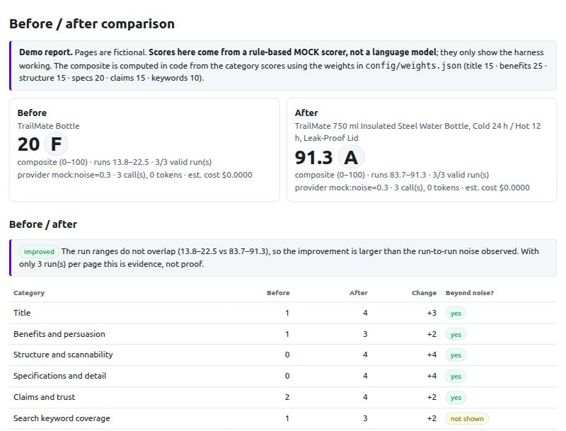

# LLM scoring harness (demo)

A small portfolio demo by Rajkamal Das about a common problem: **an LLM that grades content against a rubric gives
different grades on different runs, and the report's headline number is hard to trust.** This harness shows how to make the
grading repeatable, measurable and comparable, with the arithmetic done in code.

> **This is a demo.** The pages are fictional and the rubric is one I invented for product-page copy. Real model runs were
> **not** done (no API key was available); a rule-based **mock scorer** and a local **fake Gemini stub** were used to test it.
> See [What was verified](#what-was-verified-and-what-was-not).



*A before/after report produced with the mock scorer (not a language model). A full sample is in `docs/sample-report-mock-scorer.html`.*

## What it does

| Problem | What the harness does |
|---|---|
| **Same input, different grades** | Temperature 0 and a rubric with written level descriptions; the page is scored several times (default 3) and the **median** per category is used; raw model results are **cached** by content hash, so scoring the same page again returns identical grades without a model call. |
| **Grades contradict each other** | Things code can count (title length, bullets, measurements, superlatives) are **counted in code** and given to the model; a score is **capped** when a counted fact contradicts it. Cross-section **consistency rules** flag e.g. "score 4 but a major fix is recommended", "score 0 with no fix", "strong specs but unstructured". |
| **Scores with no basis** | Each score needs a **verbatim quote** from the page. The quote is checked against the page in code; a high score with an invented quote is limited and flagged. |
| **Composite score** | Computed **in code** from the category scores with weights in `config/weights.json` (relative weights, normalised) and grade bands. Changing weights re-scores from cached runs with **no new model calls**. |
| **Before / after** | Scores two pages and shows per-category and composite change side by side, and says whether the change is **larger than the run-to-run noise** (non-overlapping run ranges) or **within noise**. |
| **Is it actually consistent?** | `consistency` command: N independent runs of one page, comparing a single run with the median of K runs (agreement, spread, composite range, same-letter-grade rate). |
| **Cost per page** | Every report shows tokens and an estimated cost from prices you put in `config/settings.json`. |

The model's job is limited to judgement (which rubric level fits). Counting, capping, aggregating, weighting and comparing are code.

## Architecture

```
 page.md ──▶ parsePage ──▶ computeFacts (counted in code: title chars, bullets, units, superlatives)
                │
                ▼
        cache key = hash(provider+model, prompt version, rubric, page text, runs)
                │ miss                                   │ hit: reuse raw results (no model call)
                ▼                                        │
   Provider.run × K  (Gemini, temperature 0,             │
    JSON schema; or mock)                                │
                │ raw results ◀──────────────────────────┘   (cache stores RAW results only)
                ▼
   processRun (per run):  zod schema ─▶ exactly one entry per category
                          evidence quote must appear on the page (else score limited)
                          caps from counted facts (score = min(score, cap))
                ▼
   aggregate:  per-category median · spread · agreement · "runs disagree" flag
               representative run supplies fixes · cross-section consistency rules
               composite = Σ normalised weight × score/4 × 100 · grade band
                ▼
   compare (before vs after, noise-aware)  ─▶  HTML + JSON report
```

## Run it

Requires Node 20+.

```bash
npm install
npm test                                  # 45 tests
npm run score -- data/pages/aurora-lamp-revised.md
npm run compare -- data/pages/aurora-lamp-original.md data/pages/aurora-lamp-revised.md
npm run consistency -- data/pages/aurora-lamp-revised.md --n 12 --group 3
npm run simulate                          # mock-noise simulation of the method
```

Without `GEMINI_API_KEY` the commands use the **mock scorer** and say so. With a free key (`cp .env.example .env`, or export the
variable) they use Gemini. Reports are written to `out/` (HTML and JSON). Options: `--runs N`, `--provider gemini|mock`,
`--mock-noise 0..1`, `--no-cache`, `--out dir`.

**Testing the live path without a key:** `npx tsx scripts/fake-gemini.ts &`, then
`GEMINI_API_BASE=http://127.0.0.1:4010 GEMINI_API_KEY=fake npm run score -- data/pages/aurora-lamp-revised.md`. The stub grades everything 3 (with
noise on every third call) so the retry, spread and flag paths run. It proves plumbing, not quality.

## Configuration

- `config/rubric.json`: categories, written criteria and level descriptions (0–4), caps tied to counted facts, consistency rules,
  and the cap for unsupported scores. The rubric version is part of the cache key.
- `config/weights.json`: relative weights per category and the grade bands. Validated at load (unknown categories, missing weights,
  all-zero weights and a missing 0 band are rejected).
- `config/settings.json`: runs per page, the spread above which runs count as disagreeing, and token prices (0 = free tier).
  Put your provider's **current** USD prices per million tokens here to get a cost per page.
- `GEMINI_MODEL` (default `gemini-3.5-flash-lite`; `gemini-2.5-flash` returned 404 for new keys). No `thinkingConfig` is sent.
  When Gemini returns an error the log shows Google's HTTP status and message, never the key or the page.

## Evidence

**1. Simulation (mock scorer, not a language model).** `npm run simulate` gives the mock scorer random noise (each category score is
moved by one point with the given probability) and compares one run with the median of 3, over 60 runs of one page:

| Noise | One run: same letter grade | One run: composite range | Median of 3: same letter grade | Median of 3: composite range |
|---|---|---|---|---|
| 0 | 100% | 87.5–87.5 | 100% | 87.5–87.5 |
| 0.2 | 67% | 72.5–93.8 | 90% | 81.3–93.8 |
| 0.4 | 55% | 66.2–93.8 | 85% | 81.3–93.8 |
| 0.6 | 50% | 68.8–93.8 | 75% | 73.7–93.8 |

This shows what the median does **if** noise looked like this. It says nothing about how noisy a real model is. That has to be
measured with `npm run consistency` and a key.

**2. Unit tests** (45, all passing) cover counting, caps, median/spread/agreement, composite maths and weight changes, config
validation, evidence checking, consistency rules, caching (same input → no second model call; different page/model/rubric → different
entry), retry and discard of unusable runs, prompt-injection handling, the noise-aware comparison, report escaping, and the Gemini
request shape against a local stub server.

## What was verified and what was not

Verified:
- 45 tests pass and the typecheck is clean.
- The CLI runs end to end with the mock scorer (score, compare, consistency, simulate) and writes HTML/JSON reports; the HTML report
  opens and renders in a browser.
- Against the fake Gemini stub: the live code path sends temperature 0, a response schema and no `thinkingConfig`; token usage is read;
  a second run is served from the cache with no new calls; an unstable category is flagged.

**Not verified:**
- **No real model call.** I do not know how a real Gemini model behaves on these pages: its run-to-run noise, how often it fails the schema, whether
  its quotes are verbatim, or how its grades compare with a human's. The default model name `gemini-3.5-flash-lite` and the JSON-schema
  behaviour are untested here.
- **Temperature 0 does not guarantee identical outputs.** The cache makes *our* results repeatable for the same input; it cannot make the
  model itself deterministic. The median and the flags manage the remaining variation; they do not remove it.
- **No validity evidence.** Nothing here shows that the rubric's scores match what an expert would give. That needs human-labelled pages.
- The cap thresholds and the superlative word list are my invented examples; treat them as configuration to tune, not truth.
- Text only: images, layout and visual quality of a page are not scored.
- Not tested on large batches or long pages; free-tier rate limits were not exercised.

## Known limitations

- Three runs is a small sample; "beyond noise" is evidence, not a statistical test.
- The "unsupported evidence" check is a substring match: a model could quote real text that does not actually support its score.
- Page text is passed to the model as data and the system prompt says to ignore instructions in it, but no prompt is a guarantee. Scores from a
  hostile page are still bounded by the schema, the caps and the evidence check.
- One provider (Gemini) is implemented behind a small interface; others are a new file.
- File cache only; no database, no accounts, no scheduling.

## What I would do for a paid client

- Build a **gold set**: 30–100 of the client's pages graded by their own experts, then report agreement (for example weighted kappa) between the
  harness and the humans per category, and tune the rubric wording on that set, not on my examples.
- Add a **regression gate** in CI: re-score the gold set on every prompt, rubric or model change and fail if grades drift beyond a set tolerance.
- **Pairwise before/after judging** (which page is better, in both orders) in addition to absolute scores, which is usually more stable for comparisons.
- Score **images** with a vision model and keep the same cap/evidence discipline (for example counts of images, alt text and resolution measured in code).
- Version rubrics and weights with a diff view, store runs in Postgres, add a batch queue and a simple dashboard of drift over time.
- Measure cost per page on the client's real pages and choose the cheapest model and run count that meets the agreement target.

## Project layout

```
config/                 rubric.json, weights.json, settings.json
data/pages/             four fictional product pages (original and revised versions of two products)
src/facts.ts            counted facts          src/scoring.ts   caps, median, composite, consistency rules
src/score.ts            per-run checks, aggregation, pipeline, cache use      src/cache.ts   raw-result cache
src/compare.ts          noise-aware before/after    src/consistency.ts   single run vs median study
src/providers/          gemini.ts, mock.ts          src/report.ts    HTML report     src/cli.ts   commands
scripts/                simulate.ts, fake-gemini.ts
tests/                  vitest tests
docs/                   sample report and screenshot
```
